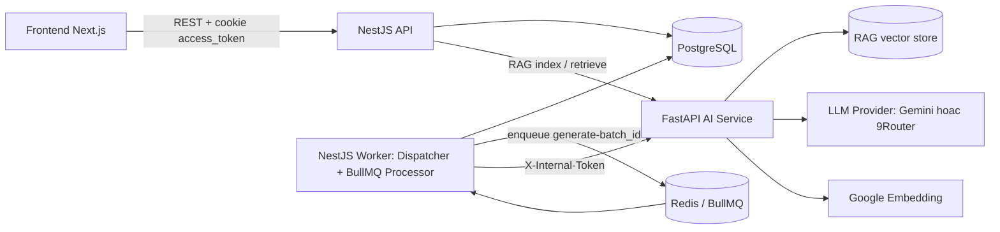
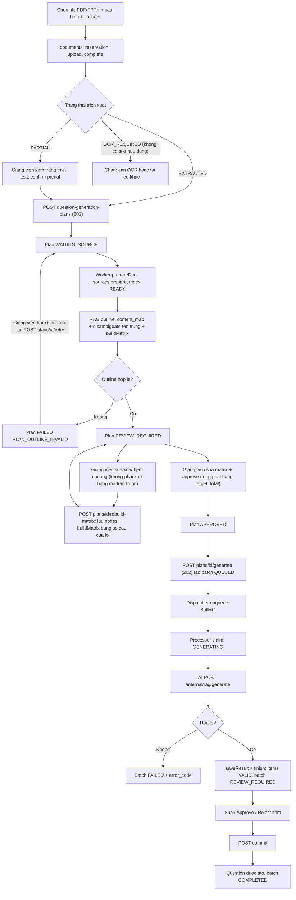
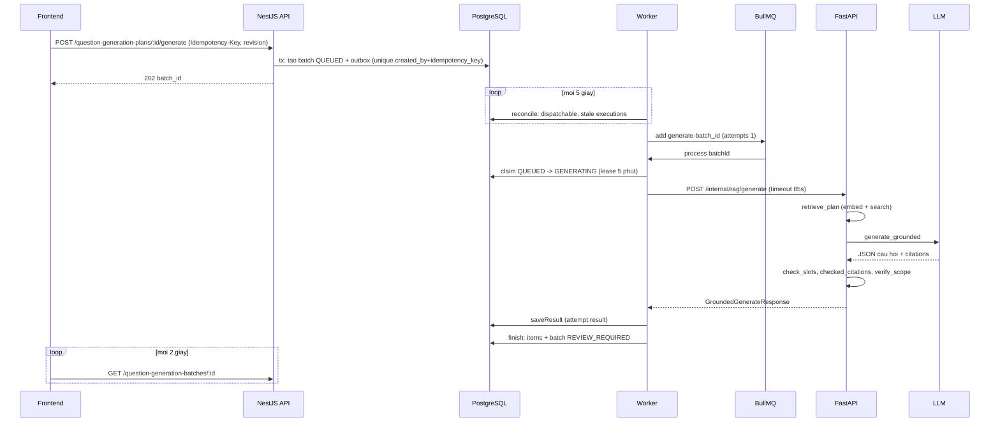
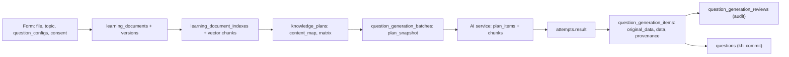
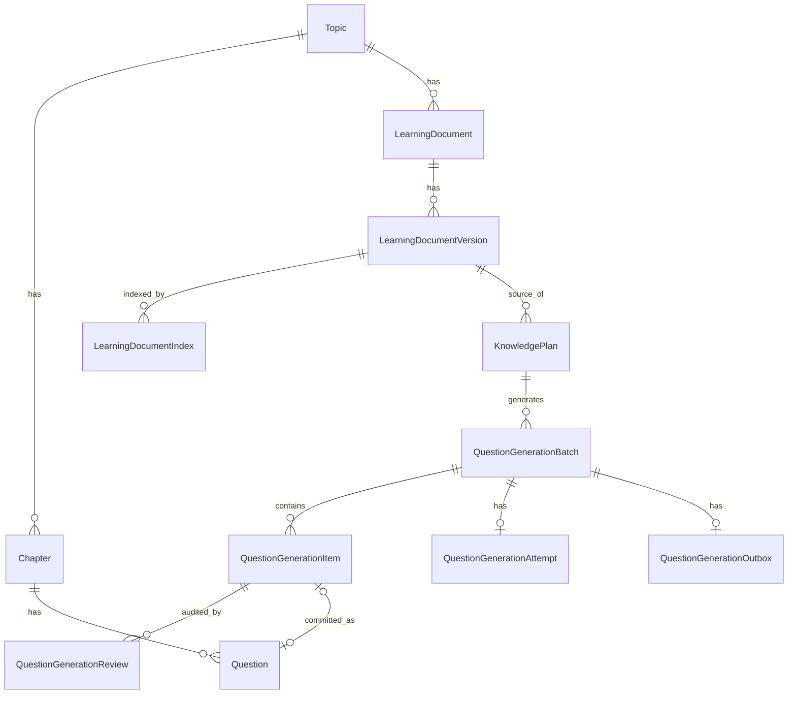
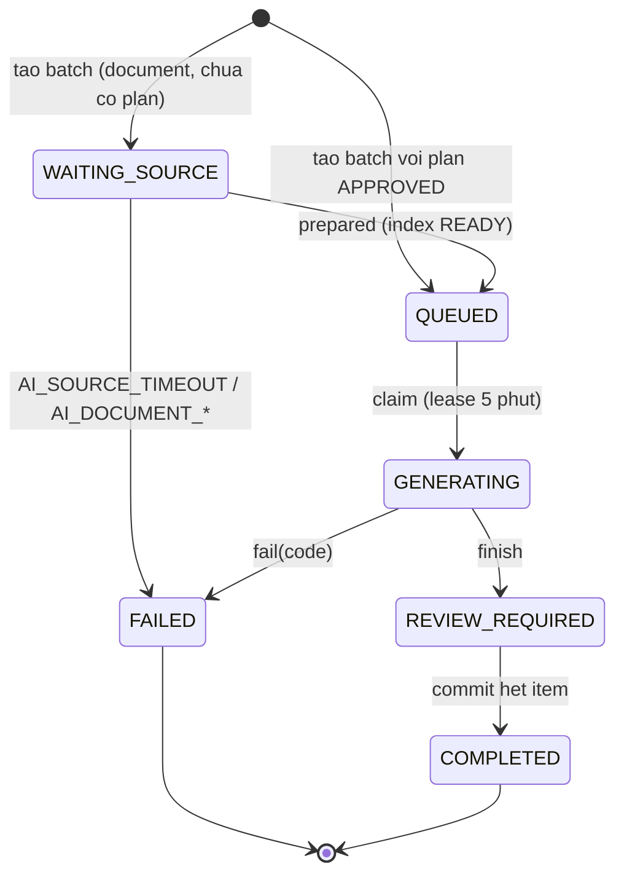

# Luồng sinh câu hỏi bằng AI (AI Question Generation Flow)

> Tài liệu mô tả kiến trúc hiện hành, được cập nhật cùng thay đổi hệ thống; bổ sung phân loại thiếu bằng chứng và chẩn đoán theo slot. Phạm vi: 3 repo `testhub-v2` (frontend), `testhub-v2-backend` (NestJS), `testhub-ai-service` (FastAPI).
> Quy ước nhãn: **Confirmed** = đã đọc mã và xác nhận; **Inferred** = suy luận từ mã; **Unverified** = chưa xác minh được. Trạng thái triển khai: **Đã triển khai / Chưa triển khai / Chưa xác minh**.
> Đường dẫn là tương đối theo từng repo: `FE:` = `testhub-v2`, `BE:` = `testhub-v2-backend`, `AI:` = `testhub-ai-service`. Số dòng có thể lệch khi mã thay đổi.
> Tài liệu cũ liên quan: `BE: docs/ai-question-generation.md` (chủ yếu mô tả chế độ text/Gemini; chưa nhắc 9Router — **Unverified** về mức độ khớp chi tiết).

---

## 1. Tổng quan (Overview)

### 1.1 Mục tiêu

Giảng viên tải tài liệu học tập (PDF/PPTX), hệ thống lập **Knowledge Plan** (bản đồ nội dung + ma trận câu hỏi), giảng viên duyệt, sau đó AI sinh câu hỏi trắc nghiệm (một đáp án / nhiều đáp án) có **trích dẫn nguồn**. Câu hỏi được lưu ở dạng **bản nháp (staging)**, giảng viên sửa/duyệt rồi mới **commit** vào ngân hàng câu hỏi (`Question`).

### 1.2 Hai chế độ sinh

| Chế độ | Contract | Trạng thái | Ghi chú |
| --- | --- | --- | --- |
| Document/RAG (qua Knowledge Plan) | `rag-generation.v1` | **Đã triển khai, là luồng duy nhất có UI** (Confirmed) | Python `POST /internal/rag/generate` với `plan_items` |
| Text (dán văn bản) | `text-generation.v1` | **Đã triển khai ở backend, chỉ qua API; không có form UI** (Confirmed: `questionGenerationService.create` và type text không có nơi gọi) | Python `POST /internal/generate` |

Luồng Word/Excel `question-imports` là luồng nhập liệu khác, **không dùng AI** (chỉ nêu để phân biệt).

### 1.3 Nhà cung cấp LLM

- `LLM_PROVIDER` = `gemini` (mặc định) hoặc `9router` (adapter OpenAI-compatible `AI: app/providers/nine_router.py`). Fallback là **opt-in**: đặt `LLM_FALLBACK_PROVIDER=gemini` để `create_provider` bọc primary bằng `FallbackProvider` (`AI: app/providers/fallback.py`). Chỉ chuyển sang Gemini khi primary ném `ProviderUnavailableError` (lỗi kết nối, 429, 5xx trừ 408/504). **Không** fallback khi timeout hoặc output không hợp lệ (lời gọi primary có thể còn chạy ở upstream và sẽ tốn thêm quota trong cùng deadline); output của fallback vẫn qua cùng bước kiểm tra schema/trích dẫn. Mặc định tắt (`AI: app/providers/factory.py`).
- **Model mặc định trong mã nguồn**: `gemini-3.5-flash-lite` (`AI: app/config.py`). **Model chạy thật** lấy từ biến môi trường `GEMINI_MODEL` hoặc `ROUTER_MODEL` (bắt buộc với 9router, không có mặc định) → giá trị runtime **Unverified**.
- Embedding luôn là Google `gemini-embedding-001` (768 chiều), độc lập với LLM provider, nên `RAG_ENABLED` vẫn yêu cầu `GEMINI_API_KEY`.

### 1.4 Các thành phần chính

| Thành phần | Vai trò |
| --- | --- |
| Frontend Next.js | Upload tài liệu, lập/duyệt plan, theo dõi batch, sửa/duyệt/commit nháp |
| NestJS (API process) | Xác thực, validate, idempotency, ghi DB, outbox |
| NestJS (worker process) | Dispatcher + BullMQ processor, chuẩn bị nguồn, gọi AI, lưu nháp |
| FastAPI `testhub-ai-service` | Truy xuất RAG, dựng prompt, gọi LLM, kiểm tra đầu ra/trích dẫn; **không có DB riêng cho câu hỏi, không ghi `Question`** |
| PostgreSQL (Prisma) | Batch, item, review, attempt, outbox, document, plan, index |
| Redis/BullMQ | Hàng đợi `ai-question-generation` |

---

## 2. Sơ đồ (Diagrams)

### 2.1 Kiến trúc tổng thể

### 2.2 Luồng end-to-end (document/RAG)

### 2.3 Sơ đồ tuần tự (từ khi tạo batch đến nháp)

### 2.4 Luồng dữ liệu (Data flow)

### 2.4b Sơ đồ ER (các bảng liên quan AI)

---

## 3. Frontend

### 3.1 Trang và component (repo `testhub-v2`)

| File | Dòng | Vai trò |
| --- | --- | --- |
| `FE: src/app/[locale]/lecturer/questions/generate/page.tsx` | 7 | Trang sinh câu hỏi |
| `FE: src/app/[locale]/lecturer/documents/page.tsx` | 6 | Trang quản lý tài liệu |
| `FE: src/components/question-generation/QuestionGenerationScreen.tsx` | 1039 | Màn hình chính: upload, tạo plan, theo dõi batch, review, commit |
| `FE: src/components/question-generation/KnowledgePlanWorkspace.tsx` | 790 | Sửa ma trận, approve, generate |
| `FE: src/components/question-generation/GenerationDraftCard.tsx` | 363 | Thẻ nháp: sửa, approve, reject |
| `FE: src/components/question-generation/QuestionConfigTable.tsx` | 200 | Bảng cấu hình loại/mức/số lượng |
| `FE: src/components/question-generation/PlanCoverage.tsx` | 79 | Độ phủ plan (**Unverified**: chưa đọc) |
| `FE: src/components/question-generation/generation-style.ts`, `generation-validation.ts`, `plan-validation.ts` | 54 / 95 / 90 | Màu badge và zod schema |
| `FE: src/components/learning-documents/LearningDocumentsScreen.tsx`, `DocumentManagePanel.tsx`, `DocumentRagPanel.tsx` | 882 / 286 / 163 | Quản lý tài liệu, index, retrieve thử |
| `FE: src/services/questionGenerationService.ts`, `knowledgePlanService.ts` | 81 / 62 | Client API |
| `FE: src/types/question-generation.ts`, `knowledge-plan.ts`, `learning-document.ts` | 127 / 59 / 133 | Kiểu dữ liệu (sao chép tay hợp đồng backend) |
| `FE: src/constants/endpoints.ts` | — | `QUESTION_GENERATION` (dòng 37), `LEARNING_DOCUMENTS` (dòng 47) |

### 3.2 Bước thao tác UI

**Bước FE-1 — Tạo plan từ file (`QuestionGenerationScreen.create`, dòng ~291)**
- Mục đích: upload file, tạo Knowledge Plan.
- Input: file, topic, `configs`, `consent`, `includeNotes`.
- Logic: validate bằng `documentGenerationSettingsSchema` + kiểm tra file (.pdf/.pptx, 1..20 MiB, tên ≤ 200); chuỗi `documentApi.create` (reservation) → `documentApi.upload` → `documentApi.complete` → `knowledgePlanService.create`; sau đó `router.replace('?plan={id}')`. Tái đặt chỗ khi `upload_expires_at` hết hạn hoặc file đổi. Khoá `createLock`/`mutationLock` chống submit đúp. Idempotency key `crypto.randomUUID()`, giữ nguyên khi lệnh canonical không đổi.
- Output: `plan_id`. Lỗi: toast; chưa thấy ánh xạ `AI_*` sang thông điệp riêng (**Unverified**).

**Bước FE-2 — Theo dõi và duyệt plan (`KnowledgePlanWorkspace`)**
- Poll `api.get(planId)` mỗi **5 giây** khi `WAITING_SOURCE|PREPARING`.
- Khi plan `FAILED` với mã `PLAN_*` (trừ `PLAN_SCOPE_REVOKED`), UI hiện thông điệp i18n theo mã (`plan.errors.*`) và nút **"Chuẩn bị lại kế hoạch"** → `knowledgePlanService.retry` → `POST /question-generation-plans/:id/retry`, sau đó tăng `loadKey` để tải lại và poll tiếp. **Tải lại trang chỉ đọc trạng thái đã lưu, không tự chạy lại plan `FAILED`.**
- Sửa danh sách chương: xóa/thêm/đổi tên/đổi cha/đổi nguồn của chương **không còn bị chặn** bởi các hàng ma trận (đã bỏ toast `removeRowsFirst`). `removeNode` xóa chương cùng nhánh con và tự loại các hàng thuộc chương đó khỏi form. Khi danh sách chương khác bản đã lưu, có hàng mồ côi, hoặc tổng số câu ≠ `target_total`, UI hiện banner cảnh báo cùng nút **"Tạo lại ma trận từ danh sách chương"** → `knowledgePlanService.rebuildMatrix` → `POST /question-generation-plans/:id/rebuild-matrix {revision, nodes}`; nút này không đi qua `handleSubmit` nên dùng được cả khi form đang không hợp lệ. Trong lúc ma trận lệch tổng, nút Approve và Generate bị khóa.
- Hành động: `save` (PATCH kèm `revision`), `rebuildMatrix`, `approve`, `generate`. Hai nút generate chỉ bật khi `APPROVED && !isDirty && !busy`: "generate" (key cache theo plan+revision → idempotent) và "generateNew" (key mới → batch mới).

**Bước FE-2b — Tài liệu trích xuất một phần (`LearningDocumentsScreen`)**
- `PARTIAL`: hiển thị "Đã trích xuất {text}/{total} trang|slide; chưa có text ở: …" (hợp của `ocr_suspected_units` và `blank_units`), cảnh báo nội dung chưa đầy đủ và nút **"Dùng phần đã trích xuất"** (có `window.confirm`) → `learningDocumentService.confirmPartial` → `POST /learning-documents/:id/versions/:versionId/confirm-partial`. Sau xác nhận hiển thị ghi chú đã xác nhận.
- `OCR_REQUIRED` với warning `NO_USABLE_TEXT` hiển thị thông điệp "không có văn bản hữu dụng" thay vì thông điệp scan thông thường.
- `isUsableVersion(version)` (`src/types/learning-document.ts`) = `EXTRACTED`, hoặc `PARTIAL` có `partial_confirmed_at`. Dùng cho `DocumentRagPanel`, link sinh câu hỏi và danh sách "dùng tài liệu có sẵn" trong `QuestionGenerationScreen` (cùng `QUEUED|PROCESSING`).

**Bước FE-3 — Theo dõi batch (`QuestionGenerationScreen`, dòng ~248–276)**
- Poll **2 giây** khi `WAITING_SOURCE|QUEUED|GENERATING`; dừng ở `REVIEW_REQUIRED/COMPLETED/FAILED`; có AbortController. Không backoff, không giới hạn thời gian, không tạm dừng khi tab ẩn (Confirmed).

**Bước FE-4 — Sửa/duyệt/từ chối (`GenerationDraftCard`, handler dòng 988–990)**
- `canEdit = editable && status ∉ {COMMITTED, SKIPPED}`; `editable = status === REVIEW_REQUIRED && !loadError`. Sửa được validate bằng `generationDraftSchema`. Approve bị khoá nếu APPROVED/INVALID; Reject khoá nếu REJECTED. Mọi `mutate()` (dòng 418) tải lại batch; lỗi 409 → toast `conflict`, khác → `actionError`.

**Bước FE-5 — Commit (dòng ~1018–1026)**
- Gửi các item APPROVED đã chọn `{id, revision}`; client timeout 90 s. Checkbox chọn chỉ bật cho item APPROVED; `selected` chỉ giữ item có revision không đổi.

### 3.3 Bảng trường form

| Field | UI Component | Data Type | Default | Validation | API Mapping |
| --- | --- | --- | --- | --- | --- |
| Nguồn (`sourceMode`) | chọn upload/existing | `'upload' \| 'existing'` | upload | — | quyết định tạo mới hay dùng `version` |
| File | input file | `File` | — | .pdf/.pptx, 1..20 MiB, tên ≤ 200 | `POST learning-documents` + upload |
| Topic | Select | string (uuid) | query `topic` | bắt buộc | `topic_id` |
| `question_type` | Select | `SINGLE_CHOICE \| MULTIPLE_CHOICE` | SINGLE_CHOICE | enum | `question_configs[].question_type` |
| `question_format` | Select | `KNOWLEDGE \| UNDERSTANDING \| APPLYING \| ADVANCED` | KNOWLEDGE | enum | `question_configs[].question_format` |
| `count` | Input số | number | 5 | 1..20 mỗi dòng; tổng ≤ 20; tối đa 20 dòng | `question_configs[].count` |
| Ghi chú (`includeNotes`) | checkbox | boolean | false | — | `include_notes` khi tạo version |
| Đồng ý xử lý bên ngoài (`consent`, id `ai-consent`) | checkbox | boolean | false | phải `true` (nút submit khoá nếu chưa chọn) | `external_processing_consent: true` |
| Idempotency key | ẩn | UUID | tự sinh | backend: `^[A-Za-z0-9._-]{16,128}$` | header `Idempotency-Key` |
| Matrix (plan) | bảng trong Workspace | `PlanMatrix` | từ `buildMatrix` / `rebuild-matrix` | nodes 1..1000, rows 1..20, counts 0..20, tổng 1..20 | `PATCH {revision, matrix}` |
| Nội dung câu hỏi (sửa nháp) | Textarea | string | — | 1–2000 | `PATCH items/:id {revision, data}` |
| Phương án (sửa nháp) | Textarea + radio/checkbox | 4 option | — | đúng 4, text 1–500, khác nhau, đáp án hợp lệ | như trên |

> Giá trị mặc định lấy từ `[newQuestionConfigRow(5)]` (Confirmed).

---

## 4. Backend (NestJS, repo `testhub-v2-backend`)

Đường dẫn gốc: `BE: src/question-generation/` và `BE: src/learning-documents/`.

### 4.1 Endpoint

**Batch** — `generation-batch.controller.ts` (class dòng 65), prefix `question-generation-batches`, `JwtGuard + RolesGuard`, `@Roles(LECTURER)`, cookie `access_token`:

| Method + Path | Dòng | Ghi chú |
| --- | --- | --- |
| `GET /` | 78 | phân trang `page`, `limit`, `topic_id` |
| `POST /` | 183 | 202, bắt buộc `Idempotency-Key` |
| `GET /:id` | 213 | trạng thái batch |
| `GET /:id/items` | 232 | danh sách nháp |
| `PATCH /:id/items/:itemId` | 99 | sửa `{revision, data}` |
| `POST /:id/items/:itemId/review` | 119 | 200, `{revision, decision: APPROVE\|REJECT}` |
| `POST /:id/commit` | 144 | 200, `items` 1..20 `{id, revision}` |

**Plan** — `knowledge-plan.controller.ts` (class dòng 49), prefix `question-generation-plans`: `POST /` (66, 202), `GET /` (77), `GET /:id` (94), `PATCH /:id` (108), `POST /:id/rebuild-matrix` (200; body `{revision, nodes}`; 400 dữ liệu/cây không hợp lệ, 409 nếu plan không ở `REVIEW_REQUIRED|APPROVED` hoặc revision lệch), `POST /:id/approve` (200; 409 `PLAN_MATRIX_TOTAL_MISMATCH`), `POST /:id/generate` (202; 409 `PLAN_MATRIX_TOTAL_MISMATCH`), `POST /:id/retry` (200; 409 `PLAN_NOT_RETRYABLE`). `GET /:id` trả thêm `target_total` (tổng `count` của `question_configs`, không lộ cấu hình).

**Learning documents** — `document.controller.ts` (prefix `learning-documents`, dòng 94): 16 route (tạo, danh sách, kiểm tra trùng, quota, chi tiết, sửa, archive/unarchive/purge, versions, history, complete, content, **`POST :id/versions/:versionId/confirm-partial`** (200, idempotent; 409 `DOCUMENT_NOT_PARTIAL`), delete). `rag.controller.ts` (91 dòng, **Unverified** chi tiết) có route index, retry index, retrieve.

### 4.2 Bước xử lý backend

**BE-1 — Tạo plan** (`KnowledgePlanService.create`, `knowledge-plan.service.ts:55`)
- Điều kiện: RAG client bật (nếu không 503); Idempotency-Key đúng regex; zod parse; `request_hash` = sha256 của `{topic_id, version_id, question_configs, external_processing_consent:true}`; `repository.create` (409 nếu trùng key với hash khác).
- DB: ghi `knowledge_plans` (status `WAITING_SOURCE`).

**BE-2 — Chuẩn bị plan** (`prepareDue`, dòng 187, chạy trong dispatcher của worker)
- `claim` token; plan quá 20 phút → FAILED `PLAN_SOURCE_TIMEOUT`; `sources.prepare`; nếu chưa READY → `WAITING_SOURCE`; nếu READY → `RagClient.outline` (content_map) → kiểm tra `version_id/document_id/source_sha256` → `disambiguateSiblings` (tên node trùng cùng cha được phân biệt bằng gợi ý từ bằng chứng ≤ 60 ký tự, rồi hậu tố "(n)", tối đa 200 ký tự; **không gộp** node) → `buildMatrix(nodes, configs)` trong `knowledge-plan.contract.ts` (phân bổ slot của lô theo vòng tròn lên tối đa `min(số lá, số slot)` lá cách đều; gom hàng theo `node/question_type`; mục tiêu mặc định "Kiểm tra kiến thức về {name}" ≤ 400 ký tự; tổng luôn bằng số câu của lô; không có lá hoặc matrix sai schema → `PlanOutlineInvalidError`) → `REVIEW_REQUIRED`. Phân loại lỗi:
  - retryable (503/504, `DocumentProcessingError.retryable`) → `WAITING_SOURCE`;
  - outline/ma trận không hợp lệ (`PlanOutlineInvalidError`, ví dụ tên chương trùng mà vẫn lọt) → FAILED **`PLAN_OUTLINE_INVALID`**;
  - nguồn không dùng được/lỗi khác → FAILED `PLAN_SOURCE_UNAVAILABLE`;
  - `PLAN_SOURCE_TIMEOUT` (quá 20 phút), `PLAN_SCOPE_REVOKED` (mất quyền).
- Trước đây mọi lỗi không retryable đều bị gộp thành `PLAN_SOURCE_UNAVAILABLE`; nguyên nhân thực tế gặp phải là hai node gốc cùng tên `Normalization` làm `planMatrixSchema` ném "Duplicate sibling chapter name".

**BE-2b — Chuẩn bị lại plan thất bại** (`KnowledgePlanService.retry`, `POST /question-generation-plans/:id/retry`)
- Chỉ khi plan `FAILED` với mã `PLAN_*` khác `PLAN_SCOPE_REVOKED`; ngược lại 409 `PLAN_NOT_RETRYABLE`. Repository đặt lại `WAITING_SOURCE`, xoá `error_code`, `execution_id`, `lease_expires_at` và bắt đầu lại cửa sổ chờ 20 phút (không đổi `revision`/`matrix`). Chỉ chạy khi người dùng bấm; không có retry tự động khi tải trang.

**BE-2c — Xác nhận dùng phần đã trích xuất** (`DocumentService.confirmPartial`)
- Chỉ cho version `PARTIAL` (ngược lại 409 `DOCUMENT_NOT_PARTIAL`); đặt `partial_confirmed_at` (idempotent) và trả `{document_id, version_id, status, partial_confirmed_at}`. `content()` trả thêm `quality` và `partial_confirmed_at`.
- Cổng nguồn (`isUsableSource(status, partial_confirmed_at)` trong `document.contract.ts`): `EXTRACTED`, hoặc `PARTIAL` đã xác nhận. Áp dụng ở `rag.service` (index/retrieve, lỗi `RAG_SOURCE_NOT_EXTRACTED`), `rag-execution.service`, `document-generation.service`, repository của plan và batch.
- `reuseExtraction` (dùng lại kết quả của file trùng hash) chỉ nhận donor có parser hiện hành (`DOCUMENT_PARSER_RULES = 'text/v2'`, `isCurrentParser`); kết quả cũ (v1) được trích xuất lại.

**BE-3 — Sửa/duyệt plan** (`edit`, `rebuildMatrix`, `approve`)
- `edit` chỉ khi `REVIEW_REQUIRED|APPROVED`, ngược lại 409; `validateUnits` kiểm tra source_units thuộc content_map. `approve` chỉ khi `REVIEW_REQUIRED`; chỉ đóng băng matrix, **không tạo chapter/question**.
- **`rebuildMatrix`** (`POST /:id/rebuild-matrix`): nhận `{revision, nodes}` (zod `rebuildSchema`, 1..1000 node), kiểm tra cây (không chu trình, không trùng tên anh em, `source_units` thuộc tài liệu) → 400 nếu sai; 409 nếu status không phải `REVIEW_REQUIRED|APPROVED`. Gọi `buildMatrix(nodes, question_configs)` rồi `repository.edit` trong một transaction có kiểm tra `revision`: lưu node mới + hàng mới, tăng `revision`, đưa status về `REVIEW_REQUIRED` (mất xác nhận cũ, phải approve lại). Hàng ma trận cũ (kể cả mục tiêu/số câu chỉnh tay) bị thay bằng hàng mới; hàng của chương đã xóa không còn tồn tại.
- **Bảo vệ tổng số câu** (`assertBatchTotal`): `approve` và `generation` ném 409 `PLAN_MATRIX_TOTAL_MISMATCH` khi tổng `count` của ma trận ≠ tổng `count` của `question_configs`, để lô luôn đủ số câu theo batch.

**BE-4 — Tạo batch** (`GenerationBatchService.create`, `generation-batch.service.ts:40`; `plan.generation`, `knowledge-plan.service.ts:151`)
- Thứ tự: `assertLecturer` → `options.enabled` (503) → regex key → `parseCommand` + kiểm tra nhất quán plan → `authorizeTarget` (+ `documents.authorize`) → hash canonical (`rag-generation.v1`/`text-generation.v1`) → `repository.create` (dòng 93).
- `repository.create` trong **một transaction**: kiểm tra target/actor/plan APPROVED; kiểm tra version thuộc `QUEUED|PROCESSING|EXTRACTED` hoặc `PARTIAL` đã xác nhận (`partial_confirmed_at` khác null), cập nhật `last_used_at`; tạo batch + outbox lồng; chế độ document bắt đầu `WAITING_SOURCE` (có plan thì `QUEUED` ngay, copy `source_index_id/profile_id` từ plan); `P2002` = replay idempotent (trùng hash → trả batch cũ, khác hash → 409).
- Output: `{batch_id, status, status_url}`.

**BE-5 — Dispatcher** (`generation-dispatcher.service.ts`, class 26, `tick` 68, `reconcile` 80)
- Mẫu transactional outbox; `setInterval` 5 s (`AI_RECONCILE_INTERVAL_MS`), page 50; chạy `plans.prepareDue()`, phục hồi execution hết lease, enqueue job `generate-{batch_id}` (`attempts:1`, `removeOnFail:1000`). Gửi lỗi → backoff luỹ thừa tối đa 300 s; `markDispatch` ghi `QUEUE_UNAVAILABLE` khi enqueue thất bại. Chỉ chạy ở process worker.

**BE-6 — Processor/Execution** (`generation.processor.ts:30`; `generation-execution.service.ts` `process` 38, `recover` 142, `finish` 182, `persist` 209)
- Processor `concurrency:2`, `maxStalledCount:1`, payload `{batchId}` zod strict.
- `process`: WAITING_SOURCE → (quá 20 phút → `AI_SOURCE_TIMEOUT`) kiểm tra actor ACTIVE, re-authorize, `documents.prepare` → `prepared`; QUEUED → `claim` (updateMany QUEUED→GENERATING, `execution_id`, lease 5 phút, tạo attempt RUNNING — **hàng rào một lần thực thi**).
- Gọi AI: document → `authorizeTarget` → `documents.generate` → `authorizeTarget`; text → `generateDrafts`.
- Lỗi → `fail(code)` (mặc định `AI_EXECUTION_REJECTED`). Với `AI_INSUFFICIENT_EVIDENCE`, lưu metadata đã làm sạch trong `attempt.result`: `{contract_version:'question-generation-failure.v1',code:'AI_INSUFFICIENT_EVIDENCE',error_details?:{issues:[{slot,reason}]}}`. Ghi failure được fence theo batch đang chạy/execution hiện hành; không ghi đè kết quả thành công đã lưu, không tạo item và không cần migration.
- Thành công → `saveResult` (lưu `attempt.result` **trước** khi dựng item) → `finish`; `persist()` thử 3 lần, trễ `attempt*100` ms.
- `recover` (lease hết hạn): parse lại kết quả thành công trong `attempt.result`; hợp lệ → `finish`; không → `fail('AI_EXECUTION_INTERRUPTED', unknown=true)`. Envelope failure không được coi là kết quả thành công. **Không gọi lại LLM** (không tốn thêm chi phí).
- GET chi tiết batch thuộc giảng viên chỉ đọc lại metadata của attempt thất bại hiện hành và xác thực lại trước khi trả optional `error_details`; `issues:[]` được giữ nguyên qua reload. Endpoint danh sách không đổi; batch `FAILED` cũ không tự được phân loại/làm lại.

**BE-7 — Sinh theo document** (`DocumentGenerationService`, `document-generation.service.ts`: `prepare` 87, `generate` 110)
- `prepare`: nếu version `EXTRACTED` hoặc `PARTIAL` đã xác nhận thì `rag.start` rồi chờ index READY; `PARTIAL` chưa xác nhận → `AI_DOCUMENT_PARTIAL_UNCONFIRMED`. Mã lỗi: `AI_DOCUMENT_OCR_REQUIRED`, `AI_DOCUMENT_PARTIAL_UNCONFIRMED`, `AI_DOCUMENT_FAILED`, `AI_INDEX_FAILED`, `AI_DOCUMENT_SOURCE_INVALID`.
- `generate`: kiểm tra lại nguồn + index; query = `source_query` hoặc tên topic (≤ 300 ký tự); gọi `RagClient.generate({owner_id, profile_id, index_ids, query, top_k: 8, question_configs, plan_items?})` (`rag-client.service.ts:212`, timeout 85 s); kiểm tra lại nguồn sau khi gọi; xác thực mọi citation (`index_id`, `document_id`, `version_id`, `source_sha256`, source_units của plan, `text_sha256`). Provenance: `rag-generation.v1`, `profile_id`, `quality_status 'UNASSESSED'`, `citations`.
- Ánh xạ lỗi: `RAG_DEADLINE/RAG_GENERATION_TIMEOUT` → `AI_SERVICE_TIMEOUT`; `RAG_OUTPUT_INVALID` → `AI_OUTPUT_INVALID`; `RAG_INSUFFICIENT_EVIDENCE` và các mã thiếu context cũ → `AI_INSUFFICIENT_EVIDENCE`; khác → `AI_SERVICE_FAILED`. Thiếu bằng chứng là lỗi không retry tự động, không phải lỗi cấu hình provider hay JSON.

**BE-8 — Sinh theo text** (`QuestionGenerationService.generateDrafts`, dòng 101; `AiQuestionClient.generate`, `ai-question-client.service.ts:41`)
- `POST {AI_SERVICE_BASE_URL}/internal/generate` với `X-Internal-Token`, `redirect:'error'`, timeout `AI_SERVICE_TIMEOUT_MS` (mặc định 35 000, tối đa 185 000). Kiểm tra 200, content-type JSON, body ≤ 1 048 576 byte, UTF-8 nghiêm ngặt, `aiGenerateResponseSchema`, `matchesQuestionConfigs`. Một lần gọi HTTP (Python tự chịu trách nhiệm retry provider).

**BE-9 — Lưu nháp** (`GenerationBatchRepository.finish`, dòng 373)
- Một transaction: kiểm tra provenance/index (document); `updateMany` GENERATING→REVIEW_REQUIRED; kiểm tra slot plan; `createMany` item (`original_data`, `data`, `provenance`, `fingerprint` sha256, `source_index` từ 1); attempt SUCCEEDED.

**BE-10 — Sửa/duyệt/commit** (`generation-review.repository.ts`: `lock` 52, `edit` 112, `review` 171, `commit` 237)
- `lock`: `updateMany` có điều kiện (lấy khoá hàng + kiểm tra quyền); status batch phải `REVIEW_REQUIRED` (COMPLETED cho phép replay commit); revision lệch → 409.
- `edit`: khoá lạc quan theo `revision`; status → VALID; thêm warning `AI_SOURCE_RECHECK_AFTER_EDIT` nếu có provenance; tính lại fingerprint; `original_data` bất biến; ghi `question_generation_reviews`.
- `review`: APPROVE yêu cầu status ≠ INVALID và schema hợp lệ.
- `commit` (một transaction, timeout 60 s): chỉ item APPROVED hoặc đã COMMITTED (replay an toàn); `tx.question.create` qua `toQuestionBankDraft` (`options` là chuỗi JSON); chapter từ `resolvePlannedChapters` hoặc `batch.chapter_id`; item → COMMITTED + `question_id`; batch → COMPLETED khi mọi item COMMITTED/REJECTED/SKIPPED; trả `{batch_id, status, questions:[{item_id, question_id}]}`.

### 4.3 Hợp đồng và hằng số (`question-generation.contract.ts`, `ai-service.config.ts`)

- Tối đa 20 câu/20 dòng cấu hình; chỉ `SINGLE_CHOICE`, `MULTIPLE_CHOICE`.
- Câu hỏi: `question_text` 1–2000; đúng 4 option (1–500 ký tự, khác nhau không phân biệt hoa thường); `correct_answer` = null; response 1–20 câu, văn bản không trùng. Single: đúng 1 đáp án; Multiple: ≥ 2 và < tổng.
- `language` phải `'vi'`; `external_processing_consent` phải `true`; `plan_id` yêu cầu chế độ document và `chapter_id` null.
- Biến môi trường: `AI_QUESTION_GENERATION_ENABLED` (mặc định false), `AI_SERVICE_BASE_URL`, `AI_SERVICE_INTERNAL_TOKEN` (32–256 ký tự ASCII), `AI_SERVICE_TIMEOUT_MS`.
- Hằng số: queue `ai-question-generation`; job `generate-text-questions` (dùng cả cho batch document); `AI_EXECUTION_LEASE_MS` 5 phút; `AI_PERSISTENCE_ATTEMPTS` 3; `AI_WORKER_CONCURRENCY` 2; `AI_DISPATCH_RECHECK_MS` 60 000.
- `TS GENERATION_BATCH_STATUSES` có `RETRY_WAIT/CANCELLED/EXPIRED` nhưng DB không có → **mã dự phòng/chết** (Confirmed).

### 4.4 Dịch vụ backend (đếm để báo cáo)

`GenerationBatchService`, `GenerationExecutionService`, `GenerationDispatcherService`, `GenerationProcessor`, `AiQuestionClient`, `DocumentGenerationService`, `GenerationReviewService`, `QuestionGenerationService`, `KnowledgePlanService`, `RagClient`, `DocumentService` → **11**.

---

## 5. Nguồn dữ liệu (Data sources)

### 5.1 Bảng Prisma (`BE: prisma/schema.prisma`)

| Bảng | Model (dòng) | Vai trò |
| --- | --- | --- |
| `question_generation_batches` | 626 | Một lần sinh |
| `question_generation_items` | 682 | Câu hỏi nháp |
| `question_generation_reviews` | 713 | Nhật ký kiểm toán sửa/duyệt/commit |
| `question_generation_attempts` | 735 | Một attempt/batch (unique `batch_id`) |
| `question_generation_outbox` | 748 | Outbox dispatch |
| `learning_documents` | 776 | Tài liệu |
| `learning_document_versions` | 801 | Phiên bản, trạng thái trích xuất |
| `knowledge_plans` | 843 | Plan, content_map, matrix |
| `learning_document_indexes` | 884 | Index RAG theo profile |
| `questions` | 351 | Đích commit |

→ **9 bảng AI** + `questions`.

### 5.2 Enum

- `QuestionGenerationBatchStatus`: QUEUED, GENERATING, REVIEW_REQUIRED, FAILED, COMPLETED, WAITING_SOURCE.
- `QuestionGenerationItemStatus`: VALID, APPROVED, INVALID, REJECTED, COMMITTED, SKIPPED.
- `QuestionGenerationReviewAction`: EDIT, APPROVE, REJECT, COMMIT. `QuestionGenerationAttemptStatus`: RUNNING, SUCCEEDED, FAILED, UNKNOWN.
- `LearningDocumentStatus`: UPLOADING, QUEUED, PROCESSING, EXTRACTED, **PARTIAL**, OCR_REQUIRED, FAILED. `LearningDocumentVersion` có thêm `quality Json?` (`{total_units, text_units, ocr_suspected_units[], blank_units[]}`) và `partial_confirmed_at DateTime?` (migration `20261102090000_add_partial_document_extraction`). `LearningDocumentIndexStatus`: QUEUED, INDEXING, READY, FAILED, REVOKED.
- `KnowledgePlan.status` là **String tự do** (mặc định `WAITING_SOURCE`), không phải enum (Confirmed). Mã lỗi plan: `PLAN_SOURCE_UNAVAILABLE`, `PLAN_SOURCE_TIMEOUT`, `PLAN_SCOPE_REVOKED`, `PLAN_OUTLINE_INVALID` (và `PLAN_NOT_RETRYABLE` của `retry`, `PLAN_MATRIX_TOTAL_MISMATCH` của `approve`/`generate` là lỗi 409, không lưu vào plan).

### 5.3 Ràng buộc đáng chú ý

- `question_generation_batches`: `@@unique([created_by, idempotency_key])`; `request_hash` Char(64).
- `question_generation_items`: `@@unique([batch_id, source_index])`; `question_id` unique; `fingerprint` **không unique**.
- `question_generation_attempts`: `batch_id` unique; **không có cột prompt, model, token, latency**.
- `Question` **không có cờ nguồn gốc AI**; truy vết chỉ qua `QuestionGenerationItem.question_id`.

### 5.4 Nguồn khác

- Redis/BullMQ (queue), kho vector RAG (Python, `RAG_DATABASE_URL`), object storage cho file nguồn/artifact (`source_key`, `artifact_key`; chi tiết **Unverified**).

---

## 6. Tích hợp AI (FastAPI `testhub-ai-service`)

### 6.1 Endpoint nội bộ

Xác thực: header `X-Internal-Token`, so sánh bằng `secrets.compare_digest` (`AI: app/api/dependencies.py:13`). Thiếu token server → 503; sai token → 401 (`RAG_UNAUTHORIZED` trên đường RAG).

| Endpoint | File:dòng | Mục đích |
| --- | --- | --- |
| `POST /internal/generate` | `app/api/generation.py:18` | Sinh từ text |
| `POST /internal/rag/generate` | `app/api/rag.py:49` | Sinh có trích dẫn |
| `POST /internal/rag/outline` | `app/api/rag.py:55` | Bản đồ nội dung (timeout 15 s) |
| `GET /internal/rag/profile` | `app/api/rag.py:81` | Profile embedding |
| `POST /internal/rag/prepare`, `/step` | `app/api/rag.py:87`, `93` | Chia chunk, embed theo lô |
| `POST /internal/rag/retrieve` | `app/api/rag.py:99` | Truy xuất |
| `POST /internal/rag/revoke` | `app/api/rag.py:105` | Thu hồi index (204) |
| `GET /health`, `GET /ready` | `app/main.py:103`, `90` | Sức khoẻ; `ready` chỉ kiểm tra RAG storage nếu `RAG_ENABLED` |

Middleware `RagBodyLimit` (`app/api/rag.py:112`, chỉ `/internal/rag/*`): kiểm tra token trước; semaphore 4 (503 `RAG_CAPACITY_REACHED` sau 0,1 s); nhận body trong 10 s (408 `RAG_INPUT_TIMEOUT`); giới hạn 8 MiB (413 `RAG_INPUT_TOO_LARGE`).

### 6.2 Cấu hình provider (`AI: app/config.py`, `Settings` dòng 9)

| Biến | Mặc định | Giới hạn |
| --- | --- | --- |
| `LLM_PROVIDER` | `gemini` | `gemini` \| `9router` |
| `GEMINI_API_KEY`, `GEMINI_MODEL` | model mã nguồn `gemini-3.5-flash-lite` | — |
| `GEMINI_TIMEOUT_MS` / `GENERATION_TIMEOUT_MS` | 30 000 / 30 000 | 1..120 000 / 1..180 000 |
| `GEMINI_MAX_ATTEMPTS` | 3 | 1..5 |
| `MAX_CONCURRENT_GENERATIONS` | 4 | 1..100 |
| `ROUTER_BASE_URL` | — (phải kết thúc bằng `/v1`) | — |
| `ROUTER_API_KEY`, `ROUTER_MODEL` | `ROUTER_MODEL` bắt buộc, không mặc định | — |
| `ROUTER_TIMEOUT_MS` | 30 000 | 1..120 000 |
| `LLM_FALLBACK_PROVIDER` | rỗng (tắt) | rỗng \| `gemini`; khác `LLM_PROVIDER`, cần `GEMINI_API_KEY` |
| `GROUNDED_GENERATION_TIMEOUT_MS` | 0 = `max(75 000, GENERATION_TIMEOUT_MS + 15 000)` | 0..300 000 |

Chuỗi deadline phải lồng nhau: `AI_SERVICE_TIMEOUT_MS` (NestJS) > deadline grounded (Python) > `GENERATION_TIMEOUT_MS` > `ROUTER_TIMEOUT_MS`. Với 9Router model suy luận chậm (~80 s), cấu hình khuyến nghị: `ROUTER_TIMEOUT_MS=100000`, `GENERATION_TIMEOUT_MS=110000` (grounded suy ra 125 000), `AI_SERVICE_TIMEOUT_MS=130000`.

Tầng 9Router: nên tạo **combo ưu tiên tuần tự** (không dùng `fusion`) trong dashboard, ví dụ `cx/gpt-6.1-sol` → `cc/claude-sonnet-5-5`, rồi đặt `ROUTER_MODEL=<tên combo>`. Combo xử lý 429/khoá tài khoản ở router; `LLM_FALLBACK_PROVIDER` chỉ là lớp cuối khi router không truy cập được.
| `ROUTER_MAX_ATTEMPTS` | 1 (không retry) | 1..5 |
| `ROUTER_MAX_OUTPUT_TOKENS` | 16 384 | 1..65 536 |
| `ROUTER_RESPONSE_FORMAT` | `json_schema` | `json_schema` \| `json_object` |
| `RAG_ENABLED` | false | cần `RAG_DATABASE_URL` + `GEMINI_API_KEY` (embedding luôn Google) |

### 6.3 Khởi tạo (`AI: app/main.py`, `lifespan` dòng 29)

Dựng `DocumentParser`; nếu `rag_enabled`: `GoogleEmbeddingProvider`, vector repository (pool `SelectorRepository` trên Windows) và `RagService` (lỗi → log `rag_initialization_unavailable`). Provider tạo qua `create_provider` khi `llm_provider == "9router"` hoặc có khoá Gemini; `ProviderError` → `generator=None` + log `generation_provider_unavailable`. `GroundedGeneration` chỉ tồn tại khi có cả rag và generator. Khi tắt, đóng mọi tài nguyên.

### 6.4 Các bước xử lý

**AI-1 — Text** (`QuestionGenerator.generate`, `AI: app/services/question_generator.py:115`)
- `wait_for(timeout_ms)` (hết hạn → `ProviderTimeoutError`); semaphore 4 với acquire 1 s, quá tải → `ServiceUnavailableError("Generation capacity reached")`.
- `_generate` (135): `build_prompt` (`app/services/prompt_builder.py:47`) → `provider.generate` → `RawQuestionList.model_validate_json` → `check_slots` (91; đếm và `answers_match`) → `GenerateResponse` (loại/mức lấy từ slot của request, `correct_answer=None`). Output sai → `InvalidQuestionsError`.
- Prompt tiếng Việt, chỉ dùng `source_text`, coi chỉ thị trong nguồn là nội dung; blueprint theo slot (4 option; 1 đúng cho SINGLE, 2 đúng cho MULTIPLE).

**AI-2 — RAG theo plan** (`GroundedGeneration.generate`, `app/services/grounded_generation.py:35`)
- Tổng thời hạn `wait_for(effective_grounded_timeout_ms)` (mặc định 75 s, cấu hình qua `GROUNDED_GENERATION_TIMEOUT_MS`). Có `plan_items`: `rag.retrieve_plan` (`app/services/retrieval.py:108`) + `generate_planned` (`question_generator.py:166`, 1 lần gọi LLM, mỗi slot chỉ nhận đoạn trích của item của nó). Không có: `rag.run("retrieve")` (nếu `context_bytes < 20` → `RAG_INSUFFICIENT_CONTEXT` 422) + `generate_grounded` (159).
- Sau đó `rag.verify_scope` (157) timeout 5 s: `TimeoutError` → `RAG_DEADLINE` 504; lỗi khác → `RAG_STORAGE_UNAVAILABLE` 503.
- `retrieve_plan`: query `"{knowledge_title}: {objective} ({format})"` (≤ 1800 byte); embed theo lô; mỗi item chỉ tìm trong `source_units` của mình; ≤ 2 chunk/item; tổng ≤ 72 000 byte. Không có chunk → `RAG_INSUFFICIENT_EVIDENCE` 422 với các slot của item đó và reason `NO_RETRIEVED_CONTEXT`, trước khi gọi LLM. Đây không phải danh sách đầy đủ mọi item thiếu nguồn: retrieval dừng tại item thiếu đầu tiên.
- Log retrieval chỉ gồm dải slot (1-based), số candidate/chunk, số byte context và số source unit; log schema chỉ gồm số lỗi và tối đa 5 vị trí/loại lỗi đã làm sạch. Không log prompt, nội dung tài liệu, output model, validation input/message hay khóa JSON tùy ý.
- `RagService.run` (30): semaphore 2 (admission 0,1 s), timeout 40 s → `RAG_CAPACITY_REACHED` 503 / `RAG_DEADLINE` 504 / `RAG_STORAGE_UNAVAILABLE` 503.
- Kiểm tra trích dẫn (`checked_citations`, 66): `chunk_id` phải nằm trong context; `locate_quote` (48) chịu được NFD/khoảng trắng nhưng từ chối khớp cắt đôi ký tự tổ hợp; quote ≤ 600; span lặp được gộp (≤ 600).
- Output: `GroundedGenerateResponse {contract_version "rag-generation.v1", profile_id, quality_status "UNASSESSED", questions 1..20}`.

**AI-3 — Trích xuất tài liệu theo trang/slide** (`app/services/document_parser_worker.py`, schema `app/schemas/document.py`)
- Mỗi đơn vị (trang PDF/slide) được phân loại: có text hữu dụng, nghi cần OCR (có ảnh/ít chữ), hoặc trắng. Ngưỡng: `MIN_USEFUL_CHARS=200` ký tự và `MIN_USEFUL_UNITS=2` đơn vị có text. Số trang/slide gốc luôn được giữ (mỗi đơn vị một span, kể cả text rỗng) để trích dẫn chính xác; **không tự bỏ** trang đầu/trang logo.
- Kết quả có `quality {total_units, text_units, ocr_suspected_units[], blank_units[]}` và `status`:
  - không có đơn vị nghi OCR: `EXTRACTED` nếu có text; không có text nào → `OCR_REQUIRED` + warning `NO_USABLE_TEXT`;
  - có đơn vị nghi OCR **và** đủ text hữu dụng → `PARTIAL` + warning `PARTIAL_EXTRACTION`;
  - còn lại → `OCR_REQUIRED`.
- Warning: `EMPTY_UNITS`, `OCR_REQUIRED`, `PARTIAL_EXTRACTION`, `NO_USABLE_TEXT`. `parser_version` có hậu tố `;text/v2`.
- `chunking` chấp nhận `EXTRACTED` và `PARTIAL`. Việc `PARTIAL` có được dùng hay không do NestJS quyết định qua `partial_confirmed_at` (AI service không giữ trạng thái xác nhận).
- `content_map.disambiguate_siblings` chạy trước khi dựng `OutlineNode`: node cùng cha trùng tên được đổi tên bằng gợi ý từ bằng chứng/hậu tố "(n)" (không gộp), kèm warning `DUPLICATE_TOPIC_NAMES_DISAMBIGUATED`. NestJS lặp lại bước này (`disambiguateSiblings`) như lớp bảo vệ thứ hai trước khi xác thực ma trận.

**AI-3 — Gọi LLM qua provider** (`QuestionProvider`: `generate`, `generate_grounded`, `aclose`)
- `GeminiProvider` (`app/providers/gemini.py:26`): SDK google-genai retry trên [408, 429, 500, 502, 503, 504], số lần = `gemini_max_attempts`, trễ 0,5–2 s có jitter; `response_mime_type=application/json` + `response_schema`; chỉ log loại lỗi/status; 408/504/timeout → `ProviderTimeoutError`, còn lại + text rỗng → `ProviderError`.
- `NineRouterProvider` (`app/providers/nine_router.py:43`): `httpx.AsyncClient`, `base_url = ROUTER_BASE_URL/`, Bearer key, `follow_redirects=False`, `trust_env=False`; `POST chat/completions` với `stream:false`, `n:1`, `max_tokens`, `response_format` (`json_schema` strict qua `_strict_objects`, hoặc `json_object` kèm schema trong system text). Kiểm tra: 200, content-type JSON, body ≤ 1 048 576 byte, đúng 1 choice, `finish_reason == "stop"`, không `refusal`/`tool_calls`, content không rỗng. Retry 408/429/500/502/503/504 + lỗi truyền tải theo `router_max_attempts`, backoff `min(0.5·2^n, 2)` trong cùng deadline. **Không ghi token, độ trễ, tên model** (Confirmed).

### 6.5 Ánh xạ lỗi (`AI: app/api/errors.py`)

`ProviderTimeoutError` → 504; `ServiceUnavailableError` → 503; `InvalidQuestionsError` → 502 ("returned invalid question JSON"); khác → 502. Trên đường RAG trả `{detail:{code, retryable:false}}` với `RAG_OUTPUT_INVALID`, `RAG_GENERATION_TIMEOUT`, `RAG_GENERATION_UNAVAILABLE`, `RAG_GENERATION_FAILED`; `RequestValidationError` → 422 `RAG_INPUT_INVALID`; `RagError` → `{code, retryable}`.

**Phân biệt thiếu bằng chứng và output không hợp lệ**

- Schema nội bộ `RawGroundedGenerationOutcome` cho phép outcome từ chối: `questions:[]`, `unsupported_slots:[{slot:2,reason:'INSUFFICIENT_EVIDENCE'}]`. Prompt yêu cầu hoặc đủ toàn bộ câu hỏi, hoặc không sinh câu nào và chỉ rõ slot không hỗ trợ được; không trả nháp một phần. `slot` tính theo thứ tự plan đã đóng băng, mở rộng từng `count`, bắt đầu từ 1.
- Parser chung cho 9Router/Gemini kiểm tra slot nguyên, duy nhất, trong phạm vi request. Outcome từ chối hợp lệ → HTTP 422 `{detail:{code:'RAG_INSUFFICIENT_EVIDENCE',retryable:false,diagnostics:{issues:[{slot:2,reason:'INSUFFICIENT_EVIDENCE'}]}}}`. Output cũ `{"questions":[]}` cũng thành lỗi thiếu bằng chứng nhưng `issues:[]`: không biết slot nào thiếu, không tự suy đoán.
- JSON/schema sai, slot chẩn đoán giả hoặc ngoài request, vừa có questions vừa từ chối, số câu không khớp, đáp án hoặc trích dẫn sai vẫn là `RAG_OUTPUT_INVALID` 502. `GroundedGenerateResponse` thành công vẫn yêu cầu 1..20 câu và giữ nguyên `rag-generation.v1`; luồng text không đổi.
- Thiếu bằng chứng không kích hoạt fallback provider, semantic retry hoặc chia batch tự động. Một lượt generation vẫn chỉ có một lời gọi logic; retry truyền tải/fallback do sự cố khả dụng vẫn theo cấu hình hiện có. Giảng viên rà soát mục tiêu, mức nhận thức, dạng câu và trang nguồn, rồi tạo batch mới; giảm số câu chỉ là lựa chọn thủ công, không đảm bảo đủ bằng chứng.
- Quote khớp nguồn chỉ bảo đảm provenance, không chứng minh tính đúng đắn/ngữ nghĩa; `quality_status` vẫn là `UNASSESSED`.

### 6.6 Cơ chế kiểm tra phía NestJS cho RAG (`rag-client.service.ts`)

- Header `X-Internal-Token`, `redirect:'error'`, giải mã UTF-8 nghiêm ngặt; timeout mặc định 55 s, `outline` 20 s, `generate` 85 s; giới hạn body: `outline` 4 194 304, `generate` 1 048 576, còn lại 256 000 byte.
- `generate` kiểm tra `profile_id`, `matchesQuestionConfigs` và mọi `chunk.index_id` ∈ `index_ids`.
- Abort → `RAG_DEADLINE` (retryable); lỗi mạng → `RAG_SERVICE_UNAVAILABLE` (retryable); response không OK → mã `RAG_*` từ `detail.code` hoặc `RAG_SERVICE_FAILED`; `retryable` chỉ true khi body báo và status ∈ {429, 502, 503, 504}; đầu ra sai → `RAG_OUTPUT_INVALID`.
- Chỉ nhận evidence diagnostics khi HTTP 422, đúng mã thiếu bằng chứng và `retryable:false`. Kiểm tra shape chặt, tối đa 20 issues, slot nguyên/duy nhất trong số câu request, reason thuộc allowlist; không nhận labels/IDs/free text. Metadata không an toàn bị bỏ toàn bộ, không làm yếu validation của kết quả thành công.

---

## 7. Vòng đời câu hỏi (Question lifecycle)

### 7.1 Trạng thái batch

### 7.2 Trạng thái item

`VALID` (mới sinh hoặc sau khi sửa) → `APPROVED` / `REJECTED`; `INVALID` không thể approve; `APPROVED` → `COMMITTED` (có `question_id`); `SKIPPED` có trong enum và bị chặn sửa/duyệt (`generation-review.repository.ts`); nơi gán trạng thái này chưa xác minh. Trạng thái plan: `WAITING_SOURCE → PREPARING → REVIEW_REQUIRED → APPROVED`, hoặc `FAILED`.

### 7.3 Chống trùng, đồng thời, huỷ

| Khía cạnh | Hiện trạng | Nhãn |
| --- | --- | --- |
| Trùng request | unique `(created_by, idempotency_key)` + `request_hash`; replay trả batch cũ, hash khác → 409 | Confirmed |
| Trùng trong batch | `question_text` khác nhau, 4 option khác nhau (zod + Pydantic) | Confirmed |
| Trùng giữa các batch / với ngân hàng | Không thấy kiểm tra; `fingerprint` chỉ tính, không unique; nút "generateNew" có thể sinh câu trùng từ cùng plan | Confirmed (không thấy) |
| Một lần commit/item | `question_id` unique | Confirmed |
| Một lần thực thi/batch | `claim` bằng `updateMany` + attempt unique theo `batch_id` | Confirmed |
| Đồng thời | Python semaphore 4 (acquire 1 s); BullMQ 2; `RagService` 2; `RagBodyLimit` 4 | Confirmed |
| Huỷ batch/plan | Không có endpoint, không có status DB (`docs/ai-question-generation.md` dòng 89, 351 khớp) | Chưa triển khai |
| Tự retry sau FAILED | Không (một attempt/batch, `attempts:1`); người dùng tạo batch mới | Chưa triển khai |
| Persistence phía Python | Không có; không ghi `Question` | Confirmed |

---

## 8. Xử lý lỗi (Error handling)

| Tình huống | Xử lý hiện tại | Vị trí mã | Rủi ro tiềm ẩn | Trạng thái |
| --- | --- | --- | --- | --- |
| Tính năng AI tắt | 503 `AI_GENERATION_DISABLED`; plan: 503 | `ai-question-client.service.ts`, `knowledge-plan.service.ts` (`create`) | Người dùng chỉ thấy lỗi chung | Đã triển khai |
| Thiếu consent | 400 `CONSENT_REQUIRED` | `question-generation.service.ts` | — | Đã triển khai |
| Idempotency-Key sai/trùng | 400 / 409 | `generation-batch.service.ts`, `generation-batch.repository.ts` | — | Đã triển khai |
| Role/target sai | 403 `AI_ROLE_FORBIDDEN` / 404 `AI_TARGET_NOT_FOUND` | `question-generation.service.ts` | — | Đã triển khai |
| AI service 401/403 | `AI_SERVICE_AUTH_FAILED` 502 | `ai-question-client.service.ts` | Lộ cấu hình sai dưới dạng 502 | Đã triển khai |
| AI service 422 | `AI_SERVICE_CONTRACT_MISMATCH` 502 | như trên | — | Đã triển khai |
| Provider lỗi 502 | `AI_PROVIDER_FAILED` 502 | như trên | — | Đã triển khai |
| 429/503 | `AI_SERVICE_UNAVAILABLE` 503 | như trên | Không retry tự động | Đã triển khai |
| 504/timeout | `AI_SERVICE_TIMEOUT` 504 | `ai-question-client.service.ts` | Lệch timeout: NestJS 35 s vs Python 30 s | Đã triển khai |
| Đầu ra AI sai | `AI_OUTPUT_INVALID` 502 / `RAG_OUTPUT_INVALID` | `ai-question-client.service.ts`, `rag-client.service.ts` | Tốn phí gọi LLM nhưng mất kết quả | Đã triển khai |
| Không đủ bằng chứng/context | `RAG_INSUFFICIENT_EVIDENCE` 422 (chấp nhận cả mã context cũ) → `AI_INSUFFICIENT_EVIDENCE`; `error_details.issues` chỉ chứa slot/reason đã xác thực | `retrieval.py`, `question_generator.py`, `rag-client.service.ts` | Batch FAILED; không có nháp, không retry/fallback semantic | Đã triển khai |
| Model trả `questions:[]` | Parser outcome riêng trả lỗi thiếu bằng chứng; `unsupported_slots` hợp lệ xác định slot, output cũ giữ `issues:[]` | `AI: app/schemas/grounded_generation.py`, `question_generator.py` | Không biết slot nếu model không báo; không tự suy đoán | Đã triển khai |
| Quá tải | 503 `RAG_CAPACITY_REACHED` / "Generation capacity reached" | `retrieval.py:30` (`run`), `question_generator.py:115` (`generate`) | Người dùng phải tạo batch mới | Đã triển khai |
| Worker chết giữa chừng | Lease 5 phút; `recover` từ `attempt.result` hoặc `AI_EXECUTION_INTERRUPTED` (unknown) | `generation-execution.service.ts:141` | Không tự gọi lại LLM | Đã triển khai |
| Lưu DB lỗi | `persist()` 3 lần; storage → 503 `ai_staging_storage_unavailable` | `generation-execution.service.ts:209` (`persist`) | — | Đã triển khai |
| Nguồn chờ quá lâu | `AI_SOURCE_TIMEOUT` (20 phút) / `PLAN_SOURCE_TIMEOUT` | execution `process`, plan `prepareDue` | — | Đã triển khai |
| Outline/ma trận không hợp lệ (ví dụ tên chương trùng) | Disambiguate trước khi xác thực; nếu vẫn sai → plan `FAILED` `PLAN_OUTLINE_INVALID` (không còn gộp vào `PLAN_SOURCE_UNAVAILABLE`) | `knowledge-plan.service.ts` (`prepareDue`), `knowledge-plan.contract.ts` (`PlanOutlineInvalidError`), `content_map.py` | Đổi tên tự động có thể chưa phản ánh đúng ngữ cảnh; giảng viên nên rà soát ở bước review | Đã triển khai |
| Retry plan thất bại | `POST /question-generation-plans/:id/retry`; 409 `PLAN_NOT_RETRYABLE` nếu không phải `FAILED` `PLAN_*` (trừ `PLAN_SCOPE_REVOKED`) | `knowledge-plan.service.ts` (`retry`), `knowledge-plan.repository.ts` | Chỉ thủ công; batch vẫn chưa có retry | Đã triển khai |
| Sửa/xóa chương làm ma trận lệch | Không chặn xóa chương; `POST /:id/rebuild-matrix` dựng lại ma trận đủ số câu; `approve`/`generate` trả 409 `PLAN_MATRIX_TOTAL_MISMATCH` nếu tổng ≠ số câu của lô | `knowledge-plan.service.ts` (`rebuildMatrix`, `assertBatchTotal`), `knowledge-plan.contract.ts` (`buildMatrix`) | Tạo lại sẽ thay các hàng đã chỉnh tay (mục tiêu/số câu); cần approve lại | Đã triển khai |
| Tài liệu `PARTIAL` chưa xác nhận | `AI_DOCUMENT_PARTIAL_UNCONFIRMED` (batch); `RAG_SOURCE_NOT_EXTRACTED` (RAG) | `document-generation.service.ts`, `rag.service.ts` | Nội dung có thể thiếu trang; cần xác nhận có chủ đích | Đã triển khai |
| Xác nhận sai trạng thái | 409 `DOCUMENT_NOT_PARTIAL` | `document.service.ts` (`confirmPartial`) | — | Đã triển khai |
| Tài liệu không có text hữu dụng | Giữ `OCR_REQUIRED` + `NO_USABLE_TEXT`; không cho xác nhận | `document_parser_worker.py` | Vài chữ header/footer không đủ để coi là nguồn | Đã triển khai |
| Enqueue thất bại | `QUEUE_UNAVAILABLE`, backoff tối đa 300 s | `generation-dispatcher.service.ts`, `markDispatch` | — | Đã triển khai |
| Xung đột revision khi sửa/duyệt/commit | 409; FE toast `conflict` | `generation-review.repository.ts` | — | Đã triển khai |
| Huỷ/hết hạn batch | Không có | — | Batch kẹt không thể huỷ | Chưa triển khai |
| Thiếu bằng chứng trên UI | Thông điệp vi/en cho `AI_INSUFFICIENT_EVIDENCE`; slot được đối chiếu với plan đóng băng để hiển thị chủ đề/mục tiêu/dạng câu; không có issues thì nói rõ chưa xác định được slot | `GenerationBatchFailure.tsx`, `QuestionGenerationScreen.tsx` | Không suy ra từ chẩn đoán rằng nguồn hoàn toàn vô dụng hoặc rằng mọi slot đều thiếu | Đã triển khai |
| Thông báo hoàn tất | Không dùng `Notification` trong hai module | grep | Người dùng phải mở trang | Confirmed (không thấy) |

### 8.1 Lệch timeout đã xác nhận

| Cặp | Tầng ngoài | Tầng trong | Kết luận |
| --- | --- | --- | --- |
| Text | NestJS 35 s | Python 30 s | Còn dư 5 s |
| RAG `generate` | NestJS `max(85 s, AI_SERVICE_TIMEOUT_MS)` | Python grounded deadline (mặc định 75 s; 125 s khi `GENERATION_TIMEOUT_MS=110000`) + 5 s scope check | Phải giữ lồng nhau; khi tăng Python phải tăng `AI_SERVICE_TIMEOUT_MS` |
| RAG `outline` | NestJS 20 s | Python 15 s | Dư 5 s |
| Commit | FE 90 s | transaction 60 s | Dư 30 s |

---

## 9. Đánh giá kiến trúc (Architecture assessment)

### 9.1 Điểm mạnh (Confirmed)

- Outbox + lease + attempt unique tạo hàng rào "một lần thực thi"; `attempt.result` lưu trước khi dựng item nên phục hồi không tốn thêm chi phí LLM.
- Idempotency hai tầng (key + hash); commit replay-safe; khoá lạc quan bằng `revision`; `original_data` bất biến; có bảng kiểm toán `reviews`.
- Trích dẫn được kiểm tra ở cả Python (chunk, quote) và NestJS (index, document, version, sha256).
- Provider tách bằng Protocol + factory, không fallback ngầm; embedding độc lập với LLM.
- Hợp đồng được kiểm tra hai phía (zod + Pydantic) và đối chiếu `matchesQuestionConfigs`.

### 9.2 Đề xuất cải tiến

| Ưu tiên | Vấn đề | Bằng chứng | Tác động | Hướng sửa | Module |
| --- | --- | --- | --- | --- | --- |
| High | Không lưu model/token/độ trễ/prompt version cho mỗi attempt | `question_generation_attempts` không có cột; provider không ghi (Confirmed) | Không kiểm toán chi phí, khó đổi provider | Thêm cột `provider`, `model`, `usage`, `latency_ms` (additive migration) + provider trả metadata | Prisma, `AiQuestionClient`, `RagClient`, `AI:providers` |
| High | `Question` không có cờ nguồn gốc AI | Schema `Question` (Confirmed) | Khó thống kê/thu hồi câu hỏi AI | Thêm `source`/`generation_item` index hoặc view; tối thiểu truy vấn qua `question_id` | Prisma, question module |
| Medium | Không huỷ batch/plan; batch chưa có retry có kiểm soát (plan `FAILED` đã có retry thủ công) | Confirmed | Batch kẹt, tốn thao tác | Thêm trạng thái `CANCELLED` (đã có phía TS) + endpoint, retry thủ công batch có idempotency | batch controller/service/repository |
| Medium | Không chống trùng giữa batch/ngân hàng | `fingerprint` không unique (Confirmed) | Câu trùng khi "generateNew" | Cảnh báo trùng dựa trên `fingerprint` khi finish/commit | `GenerationBatchRepository.finish`, review |
| Medium | `KnowledgePlan.status` là String | Schema (Confirmed) | Dễ sai giá trị | Đổi thành enum bằng migration an toàn | Prisma, plan repository |
| Medium | Mã dự phòng/chết `RETRY_WAIT/CANCELLED/EXPIRED` | contract TS vs enum DB (Confirmed) | Gây nhầm lẫn | Xoá hoặc triển khai thật | `question-generation.contract.ts` |
| Medium | Thông điệp Gemini còn sót khi dùng 9Router | `get_generator` ("Gemini API not configured…"), thông điệp trong `question_generator.py` (Confirmed) | Chẩn đoán sai | Dùng tên provider trung tính | `AI: api/dependencies.py`, `services/question_generator.py` |
| Medium | Polling cố định, hiển thị `error_code` thô | `QuestionGenerationScreen.tsx` (Confirmed) | Tải server, UX | Backoff, giới hạn thời gian, tạm dừng khi tab ẩn, ánh xạ mã lỗi sang i18n | FE screen, locales |
| Low | Hợp đồng FE sao chép tay | `types/*`, `generation-validation.ts` (Confirmed) | Dễ lệch | Sinh type từ OpenAPI/zod chung | FE types |
| Low | Luồng text không có UI; `questionGenerationService.create` mã chết ở FE | grep (Confirmed) | Mã thừa | Xoá hoặc bổ sung UI có chủ đích | FE service/types |
| Đã xử lý | Prompt/schema cho outcome thiếu bằng chứng | Test hồi quy cho output rỗng, slot thiếu/giả, output một phần và lỗi schema | Không còn biến từ chối hợp lệ thành lỗi JSON chung | `RAG_INSUFFICIENT_EVIDENCE` + chẩn đoán slot; success vẫn ≥ 1 câu | `RawGroundedGenerationOutcome`, parser chung, NestJS, UI |

Không có đề xuất mức Critical dựa trên bằng chứng đã đọc.

---

## 10. Tóm tắt (Summary)

- Luồng sống duy nhất trên UI: upload tài liệu → Knowledge Plan (outline + ma trận, duyệt) → batch → Python RAG sinh có trích dẫn → nháp `question_generation_items` → giảng viên sửa/duyệt → commit tạo `Question`.
- NestJS sở hữu toàn bộ trạng thái và persistence; FastAPI không giữ dữ liệu câu hỏi.
- 9Router được thêm như adapter thay thế Gemini bằng `LLM_PROVIDER=9router`; embedding và hợp đồng FE/NestJS không đổi.
- Tài liệu trích xuất một phần (`PARTIAL`) có thể được dùng sau khi giảng viên xác nhận, giữ nguyên số trang gốc; tài liệu không có text hữu dụng vẫn bị chặn (`OCR_REQUIRED`).
- Plan lỗi được phân loại (`PLAN_OUTLINE_INVALID` tách khỏi `PLAN_SOURCE_UNAVAILABLE`) và có thể chuẩn bị lại thủ công; tải lại trang không tự chạy lại.
- Sửa/xóa chương không bị chặn bởi hàng ma trận; giảng viên bấm "Tạo lại ma trận từ danh sách chương" để dựng lại ma trận đủ số câu của lô, và server chặn approve/generate khi tổng lệch.
- Thiếu: huỷ batch/retry batch, ghi nhận chi phí/model, chống trùng giữa batch, thông điệp lỗi thân thiện cho mã `AI_*` (mã `PLAN_*` đã có i18n).

---

## Phụ lục A — Danh mục file nguồn

| Repo | Đường dẫn | Ghi chú |
| --- | --- | --- |
| BE | `src/question-generation/generation-batch.controller.ts`, `.service.ts`, `.repository.ts` | API batch |
| BE | `src/question-generation/generation-execution.service.ts`, `generation-dispatcher.service.ts`, `generation.processor.ts` | Worker |
| BE | `src/question-generation/generation-review.repository.ts`, `.service.ts` | Review/commit |
| BE | `src/question-generation/question-generation.service.ts`, `question-generation.contract.ts`, `ai-question-client.service.ts`, `ai-service.config.ts` | Hợp đồng và client text |
| BE | `src/question-generation/document-generation.service.ts` | Sinh theo document |
| BE | `src/question-generation/knowledge-plan.controller.ts`, `.service.ts`, `.repository.ts` | Plan |
| BE | `src/learning-documents/document.controller.ts`, `rag.controller.ts`, `rag-client.service.ts` | Tài liệu, RAG |
| BE | `prisma/schema.prisma` | Mô hình dữ liệu |
| BE | `docs/ai-question-generation.md` | Tài liệu cũ (489 dòng) |
| AI | `app/main.py`, `app/config.py` | Khởi tạo, cấu hình |
| AI | `app/api/generation.py`, `rag.py`, `dependencies.py`, `errors.py` | Endpoint |
| AI | `app/services/question_generator.py`, `grounded_generation.py`, `retrieval.py`, `prompt_builder.py`, `content_map.py` | Logic |
| AI | `app/providers/factory.py`, `nine_router.py`, `gemini.py` | Provider |
| FE | `src/components/question-generation/*`, `src/components/learning-documents/*` | UI |
| FE | `src/services/questionGenerationService.ts`, `knowledgePlanService.ts`, `src/types/*`, `src/constants/endpoints.ts` | Client |

## Phụ lục B — Hợp đồng API chính

> Phụ lục B là tóm lược; schema đầy đủ xem §3–§4 và `knowledge-plan.contract.ts`, `question-generation.contract.ts`, `app/schemas/*.py`. Tên trường có thể được rút gọn.

**Tạo plan** — `POST /question-generation-plans` (header `Idempotency-Key`): `{topic_id, version_id, question_configs:[{question_type, question_format, count}], external_processing_consent:true}` → 202 plan.

**Sửa/duyệt plan** — `PATCH /:id {revision, matrix}`; `POST /:id/approve {revision}` (409 `PLAN_MATRIX_TOTAL_MISMATCH` nếu tổng ≠ `target_total`).

**Tạo lại ma trận** — `POST /question-generation-plans/:id/rebuild-matrix {revision, nodes}` → 200 plan `REVIEW_REQUIRED` (revision +1, `matrix` mới gồm `nodes` đã nhận và hàng sinh bởi `buildMatrix`, `target_total` = số câu của lô); 400 dữ liệu không hợp lệ; 409 status/revision không phù hợp.

**Chuẩn bị lại plan** — `POST /question-generation-plans/:id/retry` (không body) → 200 plan `WAITING_SOURCE`; 409 `PLAN_NOT_RETRYABLE`.

**Xác nhận trích xuất một phần** — `POST /learning-documents/:id/versions/:versionId/confirm-partial` → 200 `{document_id, version_id, status:'PARTIAL', partial_confirmed_at}`; 409 `DOCUMENT_NOT_PARTIAL`.

**FastAPI trích xuất** — `status: EXTRACTED|PARTIAL|OCR_REQUIRED`, `quality {total_units, text_units, ocr_suspected_units, blank_units}`, `warnings` gồm `PARTIAL_EXTRACTION`, `NO_USABLE_TEXT`.

**Tạo batch từ plan** — `POST /question-generation-plans/:id/generate {revision}` (+ `Idempotency-Key`) → 202 `{batch_id}`.

**Batch** — lệnh `{topic_id, chapter_id|null, plan_id?, source:{mode:'document', version_id, query}, question_configs, language:'vi', external_processing_consent:true}` → 202 `{batch_id, status, status_url}`.

**Review** — `PATCH items/:itemId {revision, data}`; `POST items/:itemId/review {revision, decision}`; `POST /:id/commit {items:[{id, revision}]}` → `{batch_id, status, questions:[{item_id, question_id}]}`.

**FastAPI RAG generate** — `{owner_id, profile_id, index_ids, query, top_k, question_configs, plan_items?}` → `{contract_version:'rag-generation.v1', profile_id, quality_status:'UNASSESSED', questions:[{..., citations}]}`.

**FastAPI text** — `{text (20–20 000), topic (≤ 200), question_configs}` → `{questions}`.

## Phụ lục C — Ánh xạ trường DB

| Nguồn | Trường DB |
| --- | --- |
| `Idempotency-Key` | `question_generation_batches.idempotency_key` (+ `request_hash`) |
| `question_configs` | `question_generation_batches.question_configs` (Json), `requested_count` |
| `consent` | `consented_at` |
| `version_id` / `query` | `source_version_id` / `source_query` |
| Plan đã duyệt | `plan_id`, `plan_snapshot`, `source_index_id`, `source_profile_id` |
| Kết quả AI | `question_generation_attempts.result` (Json) |
| Nháp | `question_generation_items.original_data` (bất biến), `data` (đã sửa), `provenance`, `fingerprint`, `revision`, `status` |
| Kiểm toán | `question_generation_reviews.before_data/after_data` |
| Commit | `questions.question_text`, `options` (chuỗi JSON), `question_type`, `question_format`, `chapter_id`; liên kết `question_generation_items.question_id` |

## Phụ lục D — Mục chưa xác minh

- Model thực chạy và hành vi thực tế của upstream 9Router (phụ thuộc môi trường).
- Nội dung chi tiết `PlanCoverage.tsx`, `rag.controller.ts`, `rag.worker.ts`, `api/documents.py`.
- Mức khớp đầy đủ giữa tài liệu này và `docs/ai-question-generation.md` (chỉ đọc lướt tiêu đề; tài liệu cũ chưa nhắc 9Router).
- Khoảng thời gian polling chính xác của `LearningDocumentsScreen`.
- Có hay không ánh xạ i18n người dùng cho mã `AI_*`.
- Migration `20261102090000_add_partial_document_extraction` (thêm `PARTIAL`, `quality`, `partial_confirmed_at`) **chưa được áp dụng vào DB nào**; cần `prisma migrate deploy` trước khi chạy.
- Kiểm thử tự động đã chạy: AI service 244 passed/4 skipped, NestJS 474 passed + `tsc` sạch, FE `tsc` sạch. Chưa kiểm thử E2E trên trình duyệt và chưa có test route cho controller `confirm-partial`/`retry`; FE không có test runner.
- Tài liệu đã lưu trước khi nâng parser lên `text/v2` có thể vẫn mang trạng thái `OCR_REQUIRED` cho tới khi được trích xuất lại.
- Hiện tượng ký tự tiếng Việt hiển thị lỗi trong console khi đọc `knowledge-plan.service.ts` có thể chỉ là lỗi mã hoá console, chưa chứng minh file hỏng.
